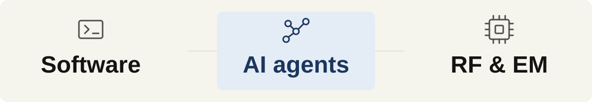

# Hongji Li

**PhD student at the University of Macau · AI Builder**

I work across electronics, speech algorithms, and full-stack development. My research interests include AI-assisted RF, electromagnetic device, and integrated circuit design. I use AI agents to build software and explore engineering simulation, testing ideas through working prototypes and experiments.

<picture>
  <source media="(prefers-color-scheme: dark)" srcset="./assets/readme/focus-dark.svg">
  
</picture>

## Selected projects

- **[cst-skills](https://github.com/LeeHongji/cst-skills)** — Agent Skills and MCP tools for CST microwave research: modeling, CAD review, simulation, optimization, and reproducible experiment records.
- **[Captor](https://github.com/LeeHongji/Captor)** — A local desktop screen recorder and video editor for demos and tutorials, maintained as a fork of Recordly. Includes local captions and MP4/GIF export.
- **[agent-second-brain](https://github.com/LeeHongji/agent-second-brain)** — Skills and workflows for a persistent Obsidian knowledge vault with Claude Code: ingest sources, organize notes, retrieve knowledge, and maintain cross-references.
- **[Cappy-visual](https://github.com/LeeHongji/Cappy-visual)** / **[hennis-visual](https://github.com/LeeHongji/hennis-visual)** — Agent skills for consistent article illustrations, visual explanations, and reusable character assets.

## Research & experience

- **RF and electromagnetics:** filters, antennas, metasurfaces, and AI-assisted design. Published related work in IEEE journals and conferences.
- **Speech and applied AI:** previously developed speech algorithms at Elevoc and worked on voice interaction and industrial RAG applications at Truth-AI. Speech algorithms I contributed to were deployed in **HUAWEI FreeLace Pro 2** and **FreeBuds 6i** earphones.
- **Education:** PhD studies at the University of Macau since 2025; BEng in Electronics and Communication Engineering, Shenzhen University, 2024.

Selected publications

- [Multistate cavity diplexers based on coaxial resonators](https://doi.org/10.1109/LMWT.2024.3416545) — *IEEE Microwave and Wireless Technology Letters*, 2024.
- [High-gain cylindrical dielectric resonator antenna](https://doi.org/10.1109/LAWP.2024.3386951) — *IEEE Antennas and Wireless Propagation Letters*, 2024.

## Tools I work with

**Algorithms & signals** — Python · C/C++ · MATLAB · PyTorch  
**Software** — TypeScript · React · Next.js · Node.js · PostgreSQL  
**Hardware & simulation** — CST Studio Suite · Altium Designer · PCB and microwave circuits

中文简介

我目前在澳门大学攻读博士，同时是一名 AI Builder。本科毕业于深圳大学电子与通信工程专业，拥有射频与电磁器件研究、语音算法开发和全栈开发经验。我喜欢动手尝试新想法，用 AI agent 做开发，并探索它在电子仿真和工程设计中的用途，通过原型与实验验证想法。这里记录我的研究工具、开发实践和视觉创作探索。

